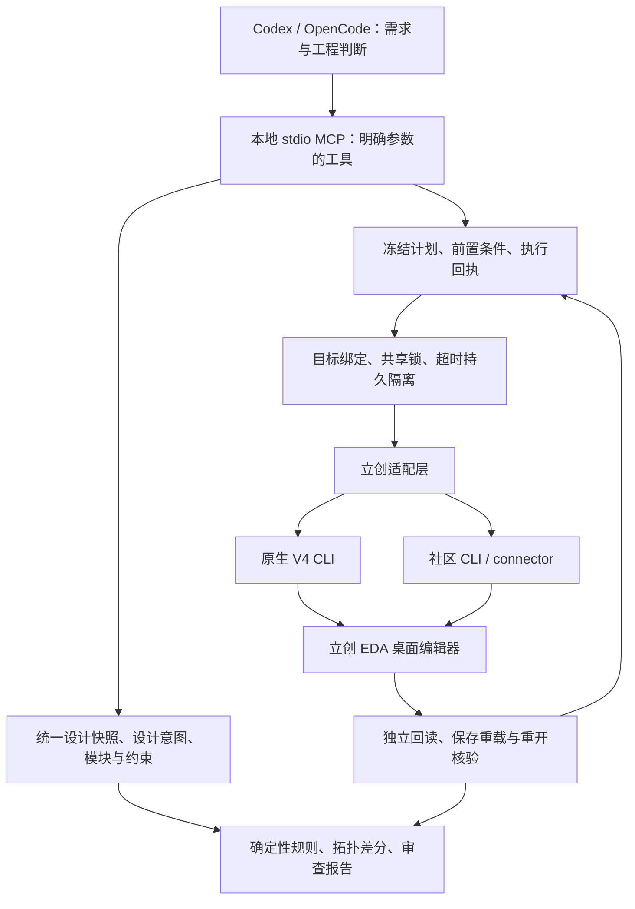

# 架构与设计边界

本文区分设计目标与已有实现，不将架构图上的模块视为全部验收通过。状态截至 2026-10-18。

## 分层设计

自有实现使用 TypeScript / Node.js 和 MCP SDK。模型负责理解需求、提出方案和解释工程依据；本地工具负责可机械检查的事实、顺序和边界。MCP 只是调用协议，不能为编辑器接口自动补上事务、保连移动或取消能力。

优先复用已有接口和计算能力，不重写整个 EDA，不把社区计算内核翻译成另一种语言。KiCad 仅作过源码/算法参考和部分纯逻辑测试，尚无本项目 KiCad 实机适配验收。独立 Agent、界面和跨平台支持仍属后续方向。

## 统一的数据与证据

| 概念 | 需要表达什么 | 关键约束 |
|---|---|---|
| 目标身份 | 文件、会话、窗口、工程、原理图/PCB 文档 | 不靠窗口焦点、显示名或旧会话标识猜目标 |
| 设计快照 | 器件、引脚/焊盘、网络、几何、单位、采集范围和来源签名 | 未读取到的数据必须标为缺测，不能用空列表冒充“没有对象” |
| 设计意图 | 期望连接、模块、接口、固定器件、电气与几何约束 | 演示工程的 ID、坐标和网络属于输入，不作为通用规则中的常量 |
| 冻结计划 | 基线、变更、顺序、约束、成功条件 | 基线变化后旧计划不能直接套用；历史签核不能沿用到不同内容 |
| 执行回执 | 已派发、已确认、部分完成、结果未知 | 命令报错不能等价于未执行，旧失败记录不得改成成功 |
| 审查报告 | 规则、对象定位、事实、推断、缺测及建议 | DRC、连通检查、功能判断分别标明覆盖范围 |

网络等价主要依据引脚集合及分区关系，不能只比较可能变化的匿名网络名。原理图原始坐标与 PCB 单位分开处理，未经验证不混用。内容、几何、连接、合法修订元数据分别核验：既不能逐字节误杀正常保存，也不能忽略真实设计变化。

## 通用工具、规则与案例的边界

通用工具接收明确的设计数据、约束和绑定目标；通用规则检查悬空、异常同网、拓扑差异、几何、模块距离及覆盖。案例负责提供电路需求、器件选择、预期网络和资格计划。案例脚本、临时修复和专项执行记录不能充当产品入口。

模块布局需要把功能归属和接口关系输入求解或规划过程，兼顾模块内紧凑、模块间走线和可读性。这是通用约束的方向及部分已有实现，不意味着所有实机布局质量都已验收。

## 执行与失败状态

修改流程设计为：绑定目标 → 读取基线 → 形成计划 → 校验范围与前置条件 → 逐步执行 → 独立回读 → 保存核验 → 必要时重开复验。当前只在部分动作和案例上走通，完整首版尚未闭环。

最新可靠性改动把文档清单分为明确未就绪、完整一致、身份冲突。只有明确未就绪可进入有上限的等待；冲突直接停止。两个接入通道及使用同一状态目录的生产 MCP 进程共享派发状态，超时留下持久记录，新进程不能绕过。

这不是底层事务系统。它不控制用户手工操作、外部插件或绕开 MCP 的直接调用，也不能阻止上游自动探针。健康检查成功、客户端退出或等待时间经过都不能证明渲染端任务完成。当前没有验证通过的通用自动取消、自动回滚和未知状态恢复能力。
